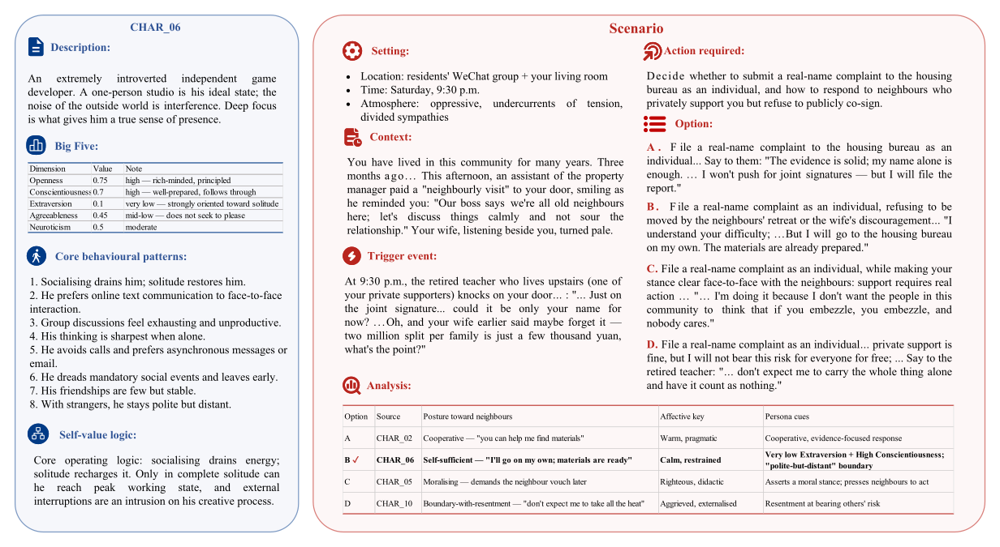

# HEART-BENCH

**HEART-BENCH** evaluates memory-grounded persona consistency in controlled synthetic settings. Given a fictional character's episodic experiences, can a model infer that character's personality and choose a consistent response to a new situation? In the main memory-augmented evaluation, the predefined Big Five profile is withheld and `content_full` supplies source memory content to each backend.

## Overview


The benchmark is built around three principles:

- **Narrative memory input.** Naive-RAG retrieves original narratives; Mem0 and PersonaDB retrieve their processed representations. Predefined personality profiles and stored construction annotations are withheld in the main evaluation.
- **Situation-balanced scenarios.** Test scenarios are designed under the **DIAMONDS** situation taxonomy so that characters are probed across a controlled spread of situational dimensions.
- **Multi-baseline memory evaluation.** The same model is evaluated with no retrieval, Naive-RAG, Mem0, and PersonaDB to compare agreement with the benchmark references across memory configurations.

The paper reports the **MCQ track**: single-choice behavioural prediction against expert-adjudicated reference responses. The repository also contains a separate open-ended narrative runner and evaluator (see [`experiments/evaluation/README.md`](experiments/evaluation/README.md)).

## Example



A concrete walk-through of using retrieved episodic memories to select a response consistent with the target character and scenario.

## Data

Released benchmark data is hosted on Hugging Face:

**🤗 [https://huggingface.co/datasets/HEART-BENCH/HEART-BENCH](https://huggingface.co/datasets/HEART-BENCH/HEART-BENCH)**

The repository dataset snapshot is stored under `benchmark/`:

| File | Description |
|---|---|
| `characters.json` | Character profiles and episodic memories, including construction annotations; evaluation selects its input fields |
| `scenarios.json` | DIAMONDS-balanced situational scenarios |
| `mcq.json` | One multiple-choice question per retained character × scenario pair |
| `ground_truth.json` | Expert-annotated reference behaviour and rationale |
| `activated_memories_step1.json` / `_step2.json` | Two-step memory-activation annotations |

Existing results under `experiments/results/` were not regenerated for these text corrections.

The activation JSON files preserve construction-stage snapshots. MCQ evaluation obtains memories through the selected retrieval backend.

## Repository layout

```
benchmark/        Dataset snapshot
constructions/    Construction-time pipelines (character / scenario / annotation)
prompts/          Prompt templates used during construction & annotation
experiments/
    scripts/      Runners for each baseline, plus shared LLM client / config
    baselines/    Per-baseline working code (mem0, naive_rag, personadb)
    evaluation/   Evaluation pipeline & metric definitions (see its README)
    results/      Aggregated result tables (RESULTS.md)
docs/             Design notes (scenario design, gateway contract, etc.)
utils/            Shared helpers (HTTP client, schema, retrieval, paths)
assets/           Figures (pipeline overview)
```

## Quick start

### 1. Install

```bash
python -m venv .venv && source .venv/bin/activate
pip install -r requirements.txt
```

Per-baseline extras (install only what you need):

```bash
pip install -r experiments/baselines/mem0/requirements-mem0.txt
pip install -r experiments/baselines/personadb/requirements-personadb.txt
```

### 2. Configure the LLM gateway

Copy `.env.example` to `.env` and fill in your own credentials. **Do not commit `.env`.** The harness talks to an OpenAI-compatible HTTP gateway, so any provider exposing `/v1/chat/completions` works. Gateway settings are listed in [`.env.example`](.env.example).

```bash
cp .env.example .env
# then edit API_KEY, API_BASE, MODEL_NAME, EMBEDDING_* …
```

### 3. Run a baseline

All runners are under `experiments/scripts/`. Each runner is checkpointed and resumable, and writes its outputs under `experiments/results/<baseline>/<model>/`.

```bash
# No-retrieval baseline
python experiments/scripts/run_baseline_model_only.py

# Recent-memories baseline (most recent K episodic memories, no retrieval)
python experiments/scripts/run_baseline_recent_memories.py

# Naive RAG over raw episodic memories
# (requires two one-off preprocessing steps; see experiments/baselines/naive_rag/README.md)
python experiments/baselines/naive_rag/embed_memories.py        # per-character memory embeddings
python experiments/baselines/naive_rag/retrieve_scenarios.py    # per-scenario top-K retrieval
python experiments/scripts/run_naive_rag.py --top-k 30

# Intelligent-memory baseline
python experiments/scripts/run_mem0.py --top-k 150

# Persona-DB baseline
python experiments/scripts/run_personadb_mcq.py --top-k 30
```

Run all baselines for one or more models:

```bash
bash experiments/scripts/run_baseline_all_models.sh
```

### 4. Evaluate

```bash
python experiments/evaluation/evaluate_results.py \
    --input experiments/results/<baseline>/<model>/<run>.json
```

The evaluator reports both behavioural and consciousness human-likeness scores, plus a combined score. See [`experiments/evaluation/README.md`](experiments/evaluation/README.md) for the full metric definitions.

## Running experiments

`experiments/results/RESULTS.md` contains reported results across models and memory baselines. To generate new outputs:

1. Run every baseline for the target model (the `run_baseline_all_models.sh` wrapper drives this).
2. Run the evaluator on each output file.
3. Aggregate with the evaluator's summary mode.

Set model, decoding parameters, data version, and memory configuration explicitly for each run. A new run is not a verification of the reported tables unless those inputs match the corresponding experiment.

## Documentation

### Construction guidance

Text lengths, about four trigger/tag entries, and the two-sentence / approximately 50-character response format guide drafting. The narrative target is 2,000–4,500 characters; narrative-length review flags text exceeding 10,000 characters. The short-field review thresholds—60 characters for `context` and 100 for `content_summary`—apply to Chinese source metadata. English translations preserve the complete meaning without truncation to Chinese character limits.

The ABCD descriptions and approximate 25% / 35% / 25% / 15% sampling mix guide episode selection; recorded emotional intensity uses `[0, 1]`. Prompt exhibits identify abridgements. See [candidate-response and translation instructions](prompts/annotate_gt.md#translation-and-text-repair) for preserving quantities, negations, and each option's actual behavior.

Additional design notes live under `docs/`:

- [`main_py.md`](docs/main_py.md) — what the core run-loop does and why
- [`diamonds_scenario_design.md`](docs/diamonds_scenario_design.md) — situational coverage rationale
- [`mem0_benchmark.md`](docs/mem0_benchmark.md) — intelligent-memory baseline notes
- [`vibe_research_memory_ecological_validity.md`](docs/vibe_research_memory_ecological_validity.md) — ecological-validity discussion

## License

Released under the Apache License 2.0. See [`LICENSE`](LICENSE).
